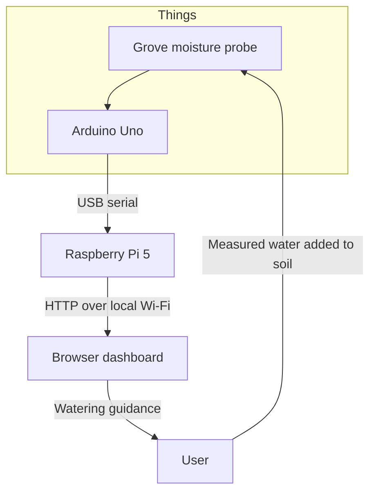

# Soil Moisture Monitoring and Water Quantity Prediction

An IoT garden prototype that connects a soil reading to a measured watering decision and a record of what happened. Built for COMP717A at the University of KwaZulu-Natal using an Arduino Uno, Grove Moisture Sensor v1.4 and Raspberry Pi 5.

The dashboard helps a user decide **when to water, how much to add next and when to stop**. Water is measured and applied by hand; the sensor supplies feedback after each portion.

Read the [project report](docs/Soil_Moisture_Monitoring_Report.pdf) for the system design, calibration and training method, evaluation results and implementation experience.


## What the system does

| Function | What it provides |
| --- | --- |
| Live monitoring | Raw ADC readings, a calibrated relative moisture index, reading age and connection state |
| Watering warnings | Confirmed dry-soil messages and an optional browser chime |
| Quantity guidance | An estimate learned from repeated watering trials, a remaining amount and a measurable next portion |
| Calibration and checks | Dry/wet references, soil/setup profiles, training runs and separate check runs |
| Historical graphs | Water additions alongside the moisture response, and predicted versus measured quantities |
| Daily and weekly summaries | Recorded water, entry counts, recorded coverage and dry-warning time using South African calendar dates |
| Records and exports | Watering entries, plant observations, system events and CSV/JSON downloads |

The project applies garden input-management goals to water. Its measured portions, soak pauses and target checks support careful water use. Comparative water savings and crop-yield improvements require further physical trials.

## How it fits together



The Uno selects the median of nine ADC samples and sends a JSON reading approximately once per second at 115200 baud. On the Pi, Python and pySerial collect readings, SQLite stores records, and Flask with Waitress serves the dashboard. Browser JavaScript draws the graphs and produces the optional chime.

See [hardware and technology choices](docs/HARDWARE.md) for the wiring and reasons for this design.

## Start on a Raspberry Pi

Clone this portfolio copy, then use Raspberry Pi OS and work from the project directory:

```bash
git clone https://github.com/DarianRobert/Soil-Moisture-Monitoring.git
cd Soil-Moisture-Monitoring
```

1. Wire the probe: **red to Uno 5V, black to GND, yellow to A0; leave white disconnected**.
2. Open `arduino/moisture_node/moisture_node.ino` in Arduino IDE. Select the classic Arduino Uno and its port, then upload. No additional Arduino libraries are needed.
3. Close Serial Monitor and connect the Uno to the Pi by USB. Power the Pi separately.
4. Install the Pi dependencies as your normal Pi user:

   ```bash
   bash pi/setup_pi.sh
   ```

   If the script adds serial permissions, reboot once before continuing.

5. Start the hardware dashboard:

   ```bash
   bash pi/start.sh
   ```

6. On the Pi, open <http://127.0.0.1:8080>. Use username `garden`; read the generated password in a second terminal:

   ```bash
   cat pi/data/access_token.txt
   ```

For a browser on another device on the same trusted local network, start with:

```bash
bash pi/start.sh --host 0.0.0.0
```

Then open `http://PI_IP:8080`, replacing `PI_IP` with the Pi's address. The example configuration listens locally by default.

Follow the [operating guide](docs/OPERATING_GUIDE.md) to calibrate, train a water profile and begin a fresh soil sample. A fresh installation has no measured references or training records.

**Updating the existing project Pi:** back up and keep its entire `pi/data/` directory and local `pi/config.json`. They contain the installation's records, calibration, trained profiles and password. The repository excludes these files. See the operating guide before replacing an existing installation.

## Dashboard examples

These images are extracted from the team's project paper and show its recorded experiment. A fresh installation displays its own readings and records.

### Watering response


The view connects four recorded additions totalling 5.5 mL to the captured moisture response, from index 4.7 to 60.1. Markers show when water was recorded; gaps and changes of stream or calibration interrupt the line.

### Prediction results


For this separate check, the final method was recalculated from the saved baseline: approximately 6.1 mL versus a measured total of 5.5 mL, a difference of 0.6 mL. The screenshot identifies this as a saved recalculation. It represents one comparison.

### Daily and weekly reporting


Totals include the saved categories shown in the chart. Recorded coverage and dry-warning time count eligible consecutive readings; gaps are excluded. They describe the recorded periods rather than continuous uptime.

## Software preview and checks

For a software preview on the Pi without a connected probe:

```bash
bash pi/start.sh --simulate
```

Simulation uses a separate database and is labelled in the dashboard. It does not reproduce the measured trial records or automatically supply a trained water-quantity profile. Stop any other process using the same port first.

Run the supplied tests after installing the Python dependencies:

```bash
python3 -m unittest discover -s tests -v
node --test tests/test_dry_warning.js
```

See [verification details](docs/TESTING.md) for the tested environment, coverage and developer setup.

## Source layout

| Path | Purpose |
| --- | --- |
| `arduino/moisture_node/` | Uno sampling and serial JSON sketch |
| `pi/app.py` | Dashboard entry point |
| `pi/core.py`, `pi/collector.py`, `pi/store.py` | Sensor handling, decision rules and storage |
| `pi/dose_*.py` | Water profiles, training/check records, prediction and sample tracking |
| `pi/analytics.py` | History graphs and calendar summaries |
| `pi/templates/`, `pi/static/` | Dashboard interface, charts and sound controls |
| `pi/setup_pi.sh`, `pi/start.sh`, `pi/install_service.sh` | Pi installation, startup and background service |
| `pi/backup.py` | Consistent database backup |
| `tools/analyze.py` | Summary of exported experimental data |
| `tests/` | Supplied software checks |
| `docs/` | Project report and hardware, operating and verification documentation |

## My role and project provenance

I am one of the five credited authors of this UKZN team project. This portfolio fork preserves the shared implementation and the [original team repository's commit history](https://github.com/ArjunRamphal/garden-iot-watering-guidance).

The earlier report-only portfolio copy, including its LaTeX source and diagrams, remains available in [Soil-Moisture-Monitoring-Legacy](https://github.com/DarianRobert/Soil-Moisture-Monitoring-Legacy/tree/main/report).

## Project team

Keolin Naicker, Lokadi Naicker, Arjun Ramphal, Darian Robert and Ntethelelo Shabalala.

This was a group project for **COMP717A Contemporary Topics in Computer Science A, University of KwaZulu-Natal**.

## Source maintenance checks

```bash
python -m unittest discover -s tests -v
node --test tests/test_dry_warning.js
```

The Python suite also checks garden/demo backups with committed SQLite WAL data, optional configuration and missing databases. The backup command writes a temporary archive before publishing it and closes both database connections. Sensor calibration, decision thresholds and watering calculations are unchanged by the formatting pass. Hardware checks still require the Uno and soil sensor.
